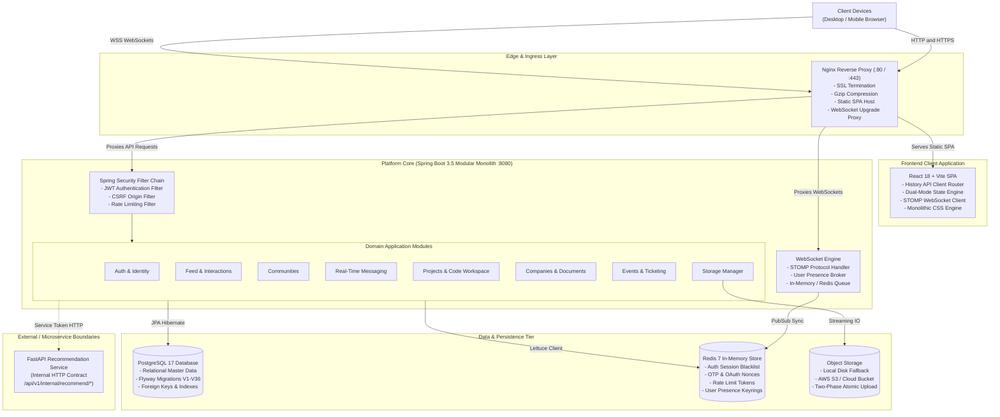
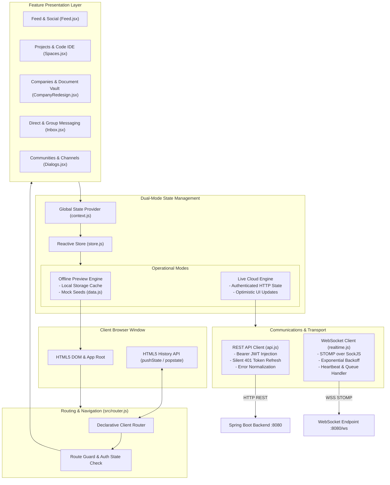
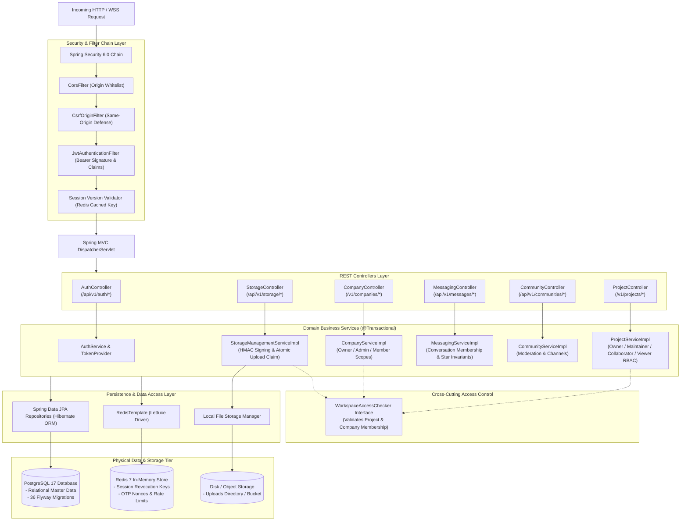
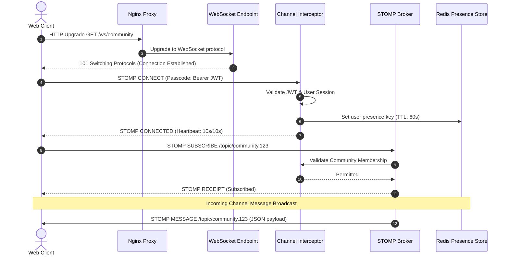
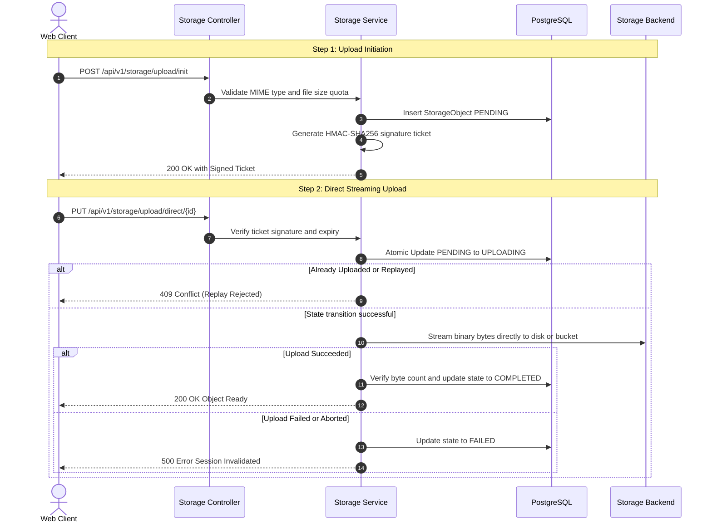
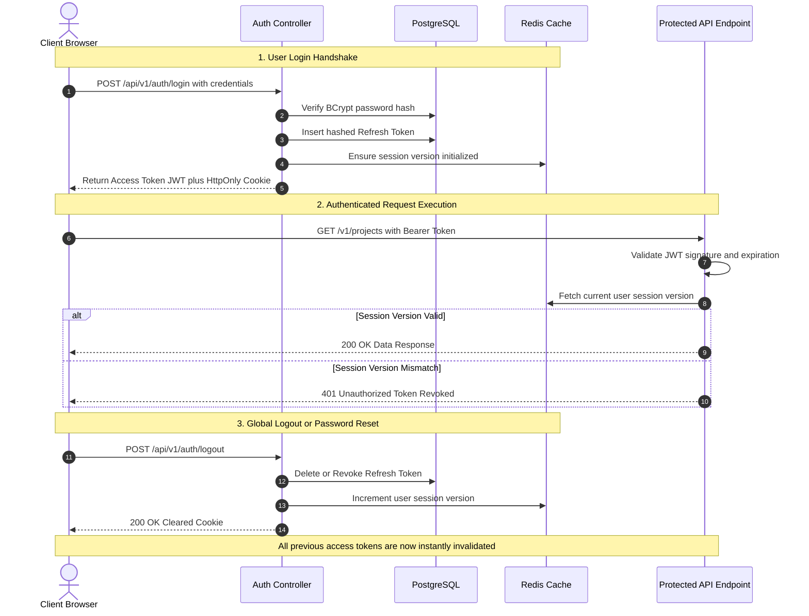
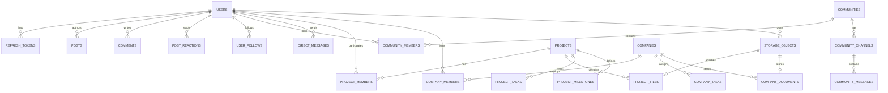
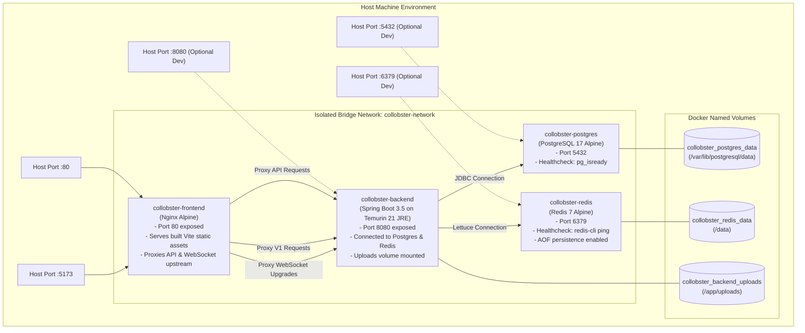

# Collobster — Full-Stack Collaborative Engineering & Learning Platform

[](https://github.com/saiprakash-nexarats/collabster/actions/workflows/ci.yml)
[](https://adoptium.net/)
[](https://spring.io/projects/spring-boot)
[](https://react.dev/)
[-4169E1?logo=postgresql&logoColor=white)](https://www.postgresql.org/)
[](https://redis.io/)
[](https://www.docker.com/)

Collobster is a production-grade, full-stack collaborative platform built for engineers, startup teams, students, and creators. It unifies project management, multi-file code development, company & startup administration, real-time messaging, community discussion circles, event ticketing, social networking, and a learning marketplace into a cohesive, high-performance web experience.

---

## Table of Contents

1. [Executive Summary & Value Proposition](#1-executive-summary--value-proposition)
2. [High-Level Architecture & System Topology](#2-high-level-architecture--system-topology)
   - [System Topology Diagram](#system-topology-diagram)
   - [Request Flow & Lifecycle](#request-flow--lifecycle)
3. [Component Architecture & Flow Diagrams](#3-component-architecture--flow-diagrams)
   - [Frontend Client (React 18 + Vite SPA)](#frontend-client-react-18--vite-spa)
   - [Frontend Architecture Diagram](#frontend-architecture-diagram)
   - [Backend Core (Spring Boot Modular Monolith)](#backend-core-spring-boot-modular-monolith)
   - [Backend Monolith Architecture Diagram](#backend-monolith-architecture-diagram)
   - [Database & Migration Engine (PostgreSQL 17 + Flyway)](#database--migration-engine-postgresql-17--flyway)
   - [In-Memory State & Caching (Redis 7)](#in-memory-state--caching-redis-7)
   - [Real-Time WebSocket & Presence Engine (STOMP + SockJS)](#real-time-websocket--presence-engine-stomp--sockjs)
   - [WebSocket & Presence Sequence Diagram](#websocket--presence-sequence-diagram)
   - [Object Storage & Media Pipeline](#object-storage--media-pipeline)
   - [Two-Phase Object Storage Sequence Diagram](#two-phase-object-storage-sequence-diagram)
   - [AI & Recommendation Subsystem Contract](#ai--recommendation-subsystem-contract)
4. [Security Architecture & Authorization](#4-security-architecture--authorization)
   - [Authentication & Token Lifecycle](#authentication--token-lifecycle)
   - [Authentication & Session Versioning Diagram](#authentication--session-versioning-diagram)
   - [Role-Based & Scope-Based Authorization](#role-based--scope-based-authorization)
   - [Storage Security & HMAC Presigned Tickets](#storage-security--hmac-presigned-tickets)
   - [Network Defense & CORS/CSRF Controls](#network-defense--corscsrf-controls)
5. [Database Schema & Data Models](#5-database-schema--data-models)
   - [Entity-Relationship Diagram](#entity-relationship-diagram)
   - [Flyway Migration History (V1–V36)](#flyway-migration-history-v1v36)
6. [Feature Modules & Domain Breakdown](#6-feature-modules--domain-breakdown)
   - [1. Authentication, Identity & Profiles](#1-authentication-identity--profiles)
   - [2. Feed, Social Interaction & Network](#2-feed-social-interaction--network)
   - [3. Communities & Discussion Circles](#3-communities--discussion-circles)
   - [4. Real-Time Direct & Group Messaging](#4-real-time-direct--group-messaging)
   - [5. Projects & Multi-File Code Workspace](#5-projects--multi-file-code-workspace)
   - [6. Companies, Startups & Document Vault](#6-companies-startups--document-vault)
   - [7. Events, Hackathons & QR Ticketing](#7-events-hackathons--qr-ticketing)
   - [8. Target Architecture & Deferred Modules](#8-target-architecture--deferred-modules)
7. [API Parity & Contract Reference](#7-api-parity--contract-reference)
8. [DevOps, Docker & Deployment Architecture](#8-devops-docker--deployment-architecture)
   - [Docker Container Topology Diagram](#docker-container-topology-diagram)
   - [Docker Compose Deployment Guide](#docker-compose-deployment-guide)
   - [Nginx Edge Reverse Proxy](#nginx-edge-reverse-proxy)
   - [Environment Variables (.env.example Reference)](#environment-variables-envexample-reference)
9. [Local Development & Quick Start](#9-local-development--quick-start)
   - [Prerequisites](#prerequisites)
   - [Running with Docker Compose](#running-with-docker-compose)
   - [Running Frontend & Backend Independently](#running-frontend--backend-independently)
   - [Dual-Mode Operation (Offline Preview vs Live Backend)](#dual-mode-operation-offline-preview-vs-live-backend)
10. [Testing Suite & Quality Verification](#10-testing-suite--quality-verification)
   - [Backend Automated Tests (JUnit 5, Mockito, Testcontainers)](#backend-automated-tests)
   - [Frontend Unit Tests (Vitest)](#frontend-unit-tests)
   - [CI/CD Automation (GitHub Actions)](#cicd-automation)

---

## 1. Executive Summary & Value Proposition

Collobster solves the fragmentation of modern engineering collaboration. Instead of juggling separate tools for project tracking, company formation, chat, code editing, and community discussion, Collobster provides:

- **Unified Digital Workspace**: Seamlessly navigate from reading community posts to opening a project codebase, editing files, updating sprint tasks, and chatting with team members in real time.
- **Enterprise-Grade Security by Default**: Zero-trust authorization checks at every service layer, short-lived cryptographic upload tokens, strict path sanitization, and session versioning for immediate global token revocation.
- **Dual-Mode Architectural Resilience**: Operates in **Offline-First Preview Mode** right in the browser using persistent local storage, and seamlessly transitions to **Live Connected Cloud Mode** when attached to the Spring Boot backend API.
- **Deterministic & Audited Data Evolution**: Strictly managed database schema using 36 additive Flyway migrations against PostgreSQL 17 with composite indexing, foreign key constraints, and cascade delete safeguards.

---

## 2. High-Level Architecture & System Topology

Collobster follows a **Canonical Multi-Tier Client-Server Architecture** featuring an Nginx edge proxy, a Single-Page Application (SPA) frontend, an enterprise Spring Boot 3.5 modular monolith, PostgreSQL 17 relational database, Redis 7 in-memory cache/broker, and an abstraction layer for cloud/local object storage.

### System Topology Diagram



### Request Flow & Lifecycle

1. **Ingress**: Incoming web requests hit **Nginx (Port 80/443)**.
   - Requests matching `/assets/*` or `/` serve pre-compiled React static assets with immutable HTTP caching.
   - Requests matching `/api/*` or `/v1/*` are proxied upstream to Spring Boot on `backend:8080`.
   - Requests matching `/ws/*` or `/realtime` are upgraded to duplex HTTP/1.1 WebSocket connections.
2. **Security & Interception**:
   - `CorsFilter` and `CsrfOriginFilter` inspect request origin against allowed whitelist.
   - `JwtAuthenticationFilter` extracts Bearer JWT, validates signature against `JWT_SECRET`, checks user session version against Redis/PostgreSQL, and populates the `SecurityContext`.
3. **Controller & Service Layer**:
   - Dispatcher routes request to the corresponding domain Controller.
   - DTOs are validated using Bean Validation (`@Valid`, `@NotNull`, `@Size`, etc.).
   - Service implementation executes business rules within `@Transactional` boundaries.
4. **Data Persistence**:
   - Relational changes commit to PostgreSQL 17 using Hibernate / Spring Data JPA.
   - Caching, session revocations, and rate limit counters execute against Redis 7 via Lettuce.
5. **Real-Time Notification**:
   - If an event produces user notifications or messages, it broadcasts over STOMP topics (`/topic/community.*`, `/queue/messages.*`).

---

## 3. Component Architecture & Flow Diagrams

### Frontend Client (React 18 + Vite SPA)

The frontend is an ultra-fast, zero-bloat Single Page Application built on **React 18** and bundled with **Vite 6**.

- **Entry Point & Bootstrapping**: `src/main.jsx` initializes the root DOM, wraps the application with error boundaries, and mounts `src/App.jsx`.
- **Client-Side Routing (`src/router.js`)**:
  - Implements a declarative router built on HTML5 History API (`pushState`, `replaceState`, `popstate`).
  - Supports deep linking with automatic synchronization across `/feed`, `/community`, `/spaces`, `/companies`, and `/messages`.
- **Dual-Mode State Machine (`src/store.js` & `src/context.js`)**:
  - **Offline Preview Mode**: Uses in-memory state seeded with rich, realistic mock datasets (`src/data.js`). State updates persist to `localStorage`.
  - **Live Cloud Mode**: Activated automatically when authenticated against a live backend API (`VITE_API_URL`). Interacts exclusively with REST endpoints via `src/api.js`.
- **API Client Layer (`src/api.js`)**:
  - Centralized, strongly-typed HTTP abstraction handling JWT headers, silent token refresh on 401, error normalization, and fallback prevention.
- **Real-Time WebSocket Client (`src/realtime.js`)**:
  - STOMP client over SockJS with exponential reconnection backoff (1s &rarr; 2s &rarr; 5s &rarr; 30s max).

### Frontend Architecture Diagram



---

### Backend Core (Spring Boot Modular Monolith)

The backend is structured as a **High-Cohesion, Loosely-Coupled Modular Monolith** under `backend/src/main/java/com/collabsphere_first/`:

```
backend/src/main/java/com/collabsphere_first/
├── account/          # Account management & settings
├── auth/             # Authentication, JWT, OAuth2, Login/Register controllers
├── common/           # Shared exceptions, base DTOs, API response envelopes
├── community/        # Communities, channels, posts, comments, moderation
├── company/          # Companies, startup stages, team members, document vault
├── explore/          # Global multi-entity search and discovery
├── feed/             # Aggregated home feed, personalized ranking
├── identity/         # User profiles, bios, skills, avatar management
├── integration/      # External adapters & webhook endpoints
├── interaction/      # Likes, bookmarks, comments, reactions, content reports
├── mail/             # Email dispatching (SMTP with retry & backoff)
├── messaging/        # 1:1 direct messages, group conversations, attachments, stars
├── network/          # User social graph (followers, following, blocks)
├── notification/     # User notification center, read receipts, category settings
├── otp/              # One-time password generation & verification
├── post/             # Feed post creation, rich media, polls
├── profile/          # Profile view models and search
├── project/          # Projects, multi-file code workspace, tasks, milestones
├── recommendation/   # Contract bridge for AI recommendation microservice
├── refreshtoken/     # Refresh token entity, rotation, and revocation
├── report/           # Abuse and moderation reporting system
├── role/             # Platform and workspace role definitions
├── security/         # Spring Security config, JWT filters, CSRF origin filter
├── storage/          # Local & S3 storage management, HMAC upload tickets
├── system/           # Health checks, readiness/liveness probes, runtime diagnostics
├── user/             # Core User JPA entity and repository
└── workspace/        # Cross-cutting workspace access control contract
```

### Backend Monolith Architecture Diagram



---

### Database & Migration Engine (PostgreSQL 17 + Flyway)

- **PostgreSQL 17**: The sole durable system of record.
- **Flyway Database Migrations**: 36 sequential, additive SQL migrations located in `backend/src/main/resources/db/migration/`:
  - Enforce strict foreign key constraints with `ON DELETE CASCADE` where child ownership is absolute (e.g., project tasks, comments).
  - Use composite unique indexes to prevent race-condition duplicates (e.g., duplicate reactions, multiple active RSVPs, duplicate stars).
  - Utilize B-Tree and GIN indexes for keyset pagination and full-text exploration.
  - Avoid breaking in-place modifications; all schema enhancements follow expanding-and-contracting migration patterns.

---

### In-Memory State & Caching (Redis 7)

Redis 7 serves as the platform's high-speed, volatile data tier:
- **Session Versioning & Token Invalidation**: Stores `user:session_version:{userId}`. Upon password reset or logout, the version increments, immediately invalidating all active JWTs.
- **OTP Verification Nonces**: Temporary storage of email/phone OTP codes with 5-minute TTLs and 3-attempt locks.
- **OAuth State Verification**: Stores CSRF nonces for Google and GitHub OAuth handshakes.
- **Rate Limiting Buckets**: Sliding-window rate limit tokens per IP and per authenticated user.
- **Live User Presence**: Heartbeat tracking keyrings for active community channels and direct chats.

---

### Real-Time WebSocket & Presence Engine (STOMP + SockJS)

- Configured in `WebSocketConfig.java` with endpoints `/ws` and `/ws/community` with SockJS fallback.
- Application Destination Prefix: `/app`, Message Broker Prefixes: `/topic`, `/queue`.
- **Channel Security**: Inbound channel interceptor validates user JWT before STOMP `CONNECT` and verifies workspace/conversation membership before permitting STOMP `SUBSCRIBE`.

### WebSocket & Presence Sequence Diagram



---

### Object Storage & Media Pipeline

Collobster implements a **Secure Two-Phase Object Storage Architecture**:
1. **Initiation (`POST /api/v1/storage/upload/init`)**:
   - Validates MIME type against approved whitelist (images, PDFs, source code).
   - Verifies file size against quota (max 25MB for general files, 100MB for project bundles).
   - Generates a `StorageObject` in `PENDING` state with a unique UUID.
   - Issues an HMAC-SHA256 signed upload ticket containing file ID, expiration timestamp, and content hash.
2. **Direct Upload (`PUT /api/v1/storage/upload/direct/{id}`)**:
   - Verifies ticket signature and expiration.
   - Atomically transitions object state from `PENDING` &rarr; `UPLOADING` to prevent replay attacks.
   - Streams raw bytes to disk/bucket without loading entire payload into JVM heap memory.
   - On completion, verifies actual byte size and sets state to `COMPLETED`.
   - On failure, marks state as `FAILED`; aborted sessions cannot be replayed.
3. **Scoped Download (`GET /api/v1/storage/files/{id}/download`)**:
   - Enforces workspace/company access rules and document visibility scopes (`admin_only` documents are restricted to company admins/owners).

### Two-Phase Object Storage Sequence Diagram



---

### AI & Recommendation Subsystem Contract

The platform defines protected internal HTTP contracts for a dedicated FastAPI recommendation service:
- `POST /api/v1/internal/recommend/feed/rank`: Re-ranks user feeds using collaborative filtering and engagement embeddings.
- `POST /api/v1/internal/recommend/feedback/batch`: Ingests user interaction batches (clicks, dwell time, bookmarks).
- `POST /api/v1/internal/recommend/privacy/erase`: Enforces GDPR compliance by erasing user recommendation vectors.
- **Deterministic Fallback**: If the recommendation service is disabled or unreachable, Spring Boot defaults to a high-speed SQL chronological-engagement ranking algorithm.

---

## 4. Security Architecture & Authorization

### Authentication & Token Lifecycle

- **Access Token**: Stateless HMAC-SHA256 JWT, 15-minute expiration, contains user ID, email, role, and session version.
- **Refresh Token**: Stored in a secure `HttpOnly`, `SameSite=Strict`, `Secure` cookie with a 7-day expiration. Stored as an SHA-256 hash in PostgreSQL table `refresh_tokens`.
- **Global Logout & Revocation**: Calling `/api/v1/auth/logout` revokes the refresh token in the database and increments `user:session_version` in Redis, instantly invalidating all outstanding access tokens across all devices.

### Authentication & Session Versioning Diagram



---

### Role-Based & Scope-Based Authorization

1. **Platform Roles**:
   - `ROLE_USER`: Standard verified user.
   - `ROLE_MODERATOR`: Can moderate community posts, resolve reports, and inspect flagged content.
   - `ROLE_ADMIN`: Platform-wide administrative capabilities.
2. **Project Workspace Roles**:
   - `owner`: Full control over project settings, deletion, member invitations, and file modifications.
   - `maintainer`: Can invite members, edit/delete files, manage tasks, and create milestones.
   - `collaborator`: Can create/edit code files, update assigned tasks, and create branches.
   - `viewer`: Strictly read-only access to files and tasks. Cannot save files, delete files, or alter task states.
   - *Public Project Rule*: Public projects allow read access to any authenticated user, but **write permissions strictly require active project membership**.
3. **Company Workspace Roles**:
   - `owner`: Full control over company equity, documents, tasks, and deletion.
   - `admin`: Can upload documents, invite members, and access `admin_only` documents.
   - `member`: Standard company collaborator; access to `team_only` documents, but blocked from `admin_only` files.

---

## 5. Database Schema & Data Models

### Entity-Relationship Diagram



### Flyway Migration History (V1–V36)

| Version | Migration Script | Description |
|:---|:---|:---|
| `V1` | `V1__create_communities_schema.sql` | Base communities table with slugs and visibility |
| `V2` | `V2__create_users_table.sql` | Users table with BCrypt passwords and verification states |
| `V3`–`V5` | Community Enhancements | Moderation toggles, member roles, and audit logging |
| `V6` | `V6__community_channels_messages.sql` | Real-time channels, message threading, and pins |
| `V8`–`V9` | Community Polls & Lifecycle | Interactive polls, lifecycle states (ACTIVE, ARCHIVED) |
| `V10`–`V12`| Community Rules & Settings | Rules engine, notification preferences, join requirements |
| `V13`–`V16`| Community Events & Outbox | Transactional outbox for event broadcasts and delivery |
| `V17` | `V17__community_categories...` | Category taxonomy and message attachments |
| `V18`–`V19`| Performance & Core Reconciliation| High-throughput B-tree indexes and schema alignment |
| `V20` | `V20__create_platform_posts.sql` | Feed posts, rich media payloads, and poll attachments |
| `V21` | `V21__create_user_network_schema.sql` | User followers, following graph, and block lists |
| `V22` | `V22__create_content_interaction...` | Post reactions, bookmarks, comments, and reports |
| `V23` | `V23__add_explore_search_indexes.sql`| GIN full-text search indexes on posts and users |
| `V24`–`V25`| Direct Messaging & Attachments | 1:1 and group conversations, messages, attachment auth |
| `V26` | `V26__create_global_notification...` | User notifications, category routing, and read states |
| `V27`–`V29`| Recommendation & Privacy Outbox | Feedback queues and GDPR right-to-be-forgotten outbox |
| `V30` | `V30__add_user_auth_session_version.sql`| Session versioning for instant multi-device token revocation |
| `V31`–`V32`| Performance & Keyset Indexes | Tiebreaker indexes for deterministic pagination |
| `V33` | `V33__create_starred_messages_schema.sql`| Persistent user-starred messages with foreign key links |
| `V34` | `V34__create_storage_objects_schema.sql`| Object storage metadata, MIME types, and file sizes |
| `V35` | `V35__storage_upload_state_hardening.sql`| Atomic upload states (PENDING, UPLOADING, COMPLETED, FAILED) |
| `V36` | `V36__create_projects_and_companies...`| Complete 9-table schema for Projects, Code Files, Tasks, Milestones, Companies, Members, and Document Vault |

---

## 6. Feature Modules & Domain Breakdown

### 1. Authentication, Identity & Profiles
- **Authentication**: Email/password registration with BCrypt hashing, OTP verification, and OAuth2 (Google & GitHub).
- **Session Security**: Stateless access tokens with automatic silent refresh via secure HttpOnly cookies.
- **Identity & User Profiles**: Customizable profiles with avatar, bio, headline, tech stack tags, portfolio links, and follower statistics.

### 2. Feed, Social Interaction & Network
- **Interactive Feed**: Dynamic social updates with support for code snippets, markdown, image galleries, and interactive polls.
- **Engagement Engine**: Real-time likes, bookmarks, threaded comments, and content reporting.
- **Social Graph**: Follow/unfollow users, inspect follower/following directories, and block abusive accounts.

### 3. Communities & Discussion Circles
- **Circle Management**: Create and configure public, private, or invite-only community hubs with custom rules.
- **Channel Hierarchy**: Multi-channel communication organized by topics (e.g., `#announcements`, `#general`, `#dev-chat`).
- **Moderation Tools**: Member role delegation (Admin, Moderator, Member), join request approval queues, and audit trails.

### 4. Real-Time Direct & Group Messaging
- **Direct & Group Chats**: 1:1 direct messages and multi-user group conversations with real-time typing indicators.
- **Message Features**: File attachments, inline image previews, delivery/read receipts, message deletion, and message starring.
- **Offline Delivery**: Messages sent while a user is offline are reliably delivered upon next connection.

### 5. Projects & Multi-File Code Workspace
- **Multi-File Code Editor**: Interactive code workspace supporting Java 21, React, TypeScript, CSS, JSON, and Markdown.
- **File Management**: Save, update, and delete project files with strict path sanitization preventing directory traversal (`..`, leading slashes).
- **Task Management**: Project kanban/sprint boards with statuses (`todo`, `in_progress`, `review`, `done`), priority levels, and member assignees.
- **Milestones**: Roadmap milestone tracking with due dates and progress percentage completion.

### 6. Companies, Startups & Document Vault
- **Startup Formation**: Company profile creation, team directories, equity stage tracking (Pre-seed, Seed, Series A), and investor pitch decks.
- **Company Tasks**: Internal company sprint management with due dates, assignees, and priority tags.
- **Secure Document Vault**: Upload and archive corporate documents (contracts, cap tables, NDAs). Enforces `admin_only` vs `team_only` access control at the byte-stream level.

### 7. Events, Hackathons & QR Ticketing
- **Event Discovery**: Hackathons, webinars, meetups, and workshops with registration deadlines and attendee caps.
- **RSVP & Ticketing**: Instant ticket generation with unique registration IDs and QR check-in verification for organizers.
- **Organizer Broadcasts**: Bulk broadcast notifications and email reminders to registered attendees.

### 8. Target Architecture & Deferred Modules
- **Learning & Courses**: Comprehensive interactive courses, practice labs, and certificates (Scheduled for Phase 5C).
- **Mentorship 1:1**: Expert booking flow, availability calendars, and session ratings (Scheduled for Phase 5C).
- **On-Demand Services Marketplace**: Milestone-backed escrow services for software, legal, and UI/UX design (Scheduled for Phase 5D).
- **WebRTC Calling**: Audio/video calling endpoints explicitly return `501 NOT_IMPLEMENTED` until dedicated STUN/TURN/SFU relay media infrastructure is provisioned.

---

## 7. API Parity & Contract Reference

Every frontend operation in `src/api.js` has been formally audited against the backend implementation. Out of **141 audited operations**, **96 are fully implemented and verified with automated tests** (68.1%), while **45 operations** are intentionally and explicitly scheduled for Phase 5C–5D.

### Core Implemented Endpoints Summary

| Method | Endpoint Path | Description | Access Scope |
|:---|:---|:---|:---|
| `GET` | `/api/v1/system/health` | Service health & database connectivity probe | Public |
| `POST` | `/api/v1/auth/register` | Register new user account | Public |
| `POST` | `/api/v1/auth/login` | Authenticate user & issue JWT | Public |
| `POST` | `/api/v1/auth/refresh-token` | Rotate refresh token & issue new access token | Cookie (HttpOnly) |
| `POST` | `/api/v1/auth/logout` | Revoke refresh token & invalidate session | Authenticated |
| `GET` | `/api/v1/users/me` | Fetch currently authenticated user profile | Authenticated |
| `GET` | `/api/v1/feed` | Retrieve personalized social feed | Authenticated |
| `POST` | `/api/v1/posts` | Create new feed post with media/polls | Authenticated |
| `POST` | `/api/v1/posts/{id}/reactions` | Add like/heart/celebrate reaction to post | Authenticated |
| `POST` | `/api/v1/posts/{id}/comments` | Submit threaded comment on post | Authenticated |
| `GET` | `/api/v1/messages/conversations` | List user direct & group conversations | Authenticated |
| `POST` | `/api/v1/messages/conversations` | Create new conversation thread | Authenticated |
| `GET` | `/api/v1/messages/conversations/{id}/messages` | Paginated messages in conversation | Conversation Member |
| `POST` | `/api/v1/messages/conversations/{id}/messages` | Send message with attachments | Conversation Member |
| `GET` | `/v1/projects` | List projects (mine + public discoverable) | Authenticated |
| `POST` | `/v1/projects` | Create new project workspace | Authenticated |
| `GET` | `/v1/projects/{id}` | Get project details & role | Project Member / Public |
| `GET` | `/v1/projects/{id}/files` | List code files in project | Project Member / Public |
| `POST` | `/v1/projects/{id}/files` | Save/update code file (sanitized path) | Owner / Maintainer / Collaborator |
| `DELETE`| `/v1/projects/{id}/files/{fileId}` | Delete code file from project | Owner / Maintainer / Collaborator |
| `GET` | `/v1/projects/{id}/tasks` | List tasks in project board | Project Member / Public |
| `POST` | `/v1/projects/{id}/tasks` | Create new project task | Owner / Maintainer / Collaborator |
| `PATCH` | `/v1/projects/{id}/tasks/{taskId}` | Update task status or assignee | Owner / Maintainer / Collaborator |
| `GET` | `/v1/companies` | List user companies | Authenticated |
| `POST` | `/v1/companies` | Create new startup/company profile | Authenticated |
| `GET` | `/v1/companies/{id}` | Get company profile and team list | Company Member |
| `POST` | `/v1/companies/{id}/documents` | Register document in vault | Company Member |
| `GET` | `/v1/companies/{id}/documents/{docId}/download`| Stream document bytes | Scoped (Admin / Team) |
| `POST` | `/api/v1/storage/upload/init` | Initiate two-phase upload & get HMAC ticket | Authenticated |
| `PUT` | `/api/v1/storage/upload/direct/{id}` | Direct streaming upload using signed ticket | Valid Signed Ticket |

*For the complete contract audit, see [`docs/audit/api-parity.md`](docs/audit/api-parity.md) and [`docs/audit/api-parity.csv`](docs/audit/api-parity.csv).*

---

## 8. DevOps, Docker & Deployment Architecture

The repository includes a production-ready **Docker Compose** orchestration stack.

### Docker Container Topology Diagram



### Docker Compose Deployment Guide

```bash
# 1. Clone repository
git clone https://github.com/saiprakash-nexarats/collabster.git
cd collabster

# 2. Configure environment secrets
cp .env.example .env
# Edit .env and supply unique values for POSTGRES_PASSWORD and JWT_SECRET

# 3. Start all services in the background
docker compose up --build -d

# 4. Check status
docker compose ps
```

### Compose Service Overview

| Service | Container Name | Image / Base | Internal Port | Host Port | Purpose |
|:---|:---|:---|:---|:---|:---|
| `postgres` | `collobster-postgres` | `postgres:17-alpine` | `5432` | `5432` | Relational master database |
| `redis` | `collobster-redis` | `redis:7-alpine` | `6379` | `6379` | Session store, rate limiting, presence |
| `backend` | `collobster-backend` | Eclipse Temurin 21 (JRE) | `8080` | `8080` | Spring Boot 3.5 API application |
| `frontend` | `collobster-frontend` | Nginx Alpine (Multi-stage build) | `80` | `80`, `5173` | Nginx reverse proxy & static SPA |

> **Production Note:** `docker-compose.yml` strictly enforces secret presence: it **refuses to start** if `POSTGRES_PASSWORD` or `JWT_SECRET` are missing or default.

### Nginx Edge Reverse Proxy

The root `nginx.conf` acts as the edge entry point:
- Terminates HTTP requests, enables gzip compression for all static MIME types.
- Adds OWASP security headers (`X-Frame-Options`, `X-Content-Type-Options`, `X-XSS-Protection`).
- Applies a 1-year immutable cache policy to `/assets/` static assets.
- Proxies `/api/` and `/v1/` to `http://backend:8080/`.
- Handles WebSocket upgrades for `/ws/` and `/realtime` with 24-hour read/send timeouts.
- Provides SPA fallback via `try_files $uri $uri/ /index.html` for clean client-side routing.

### Environment Variables (.env.example Reference)

```dotenv
# ==============================================================================
# DATABASE CONFIGURATION (PostgreSQL 17)
# ==============================================================================
POSTGRES_DB=collabster1
POSTGRES_USER=postgres
POSTGRES_PASSWORD=replace-with-a-secure-database-password-min-16-chars

# ==============================================================================
# REDIS CONFIGURATION (Redis 7)
# ==============================================================================
SPRING_REDIS_HOST=redis
SPRING_REDIS_PORT=6379

# ==============================================================================
# SECURITY & AUTHENTICATION SECRETS
# ==============================================================================
# Base64 or 256-bit secret string for signing HMAC-SHA256 JWT tokens
JWT_SECRET=replace-with-a-random-64-character-hex-string-for-jwt-signing
COLLOBSTER_CORS_ALLOWED_ORIGINS=http://localhost,http://localhost:80,http://localhost:5173,http://localhost:3000

# ==============================================================================
# FILE STORAGE CONFIGURATION
# ==============================================================================
FILE_UPLOAD_DIR=uploads

# ==============================================================================
# FRONTEND BUILD CONFIGURATION
# ==============================================================================
VITE_API_URL=/api
```

---

## 9. Local Development & Quick Start

### Prerequisites
- **Node.js**: v18.0.0 or higher (v20+ recommended)
- **Java Development Kit (JDK)**: Java 17 or Java 21 (Eclipse Temurin recommended)
- **Maven**: 3.9+ (or use the included `./mvnw` wrapper)
- **Docker & Docker Compose**: v2.20+ (for containerized dependencies)

### Running with Docker Compose (Recommended)
The fastest way to run the entire stack with real PostgreSQL 17 and Redis 7:
```bash
cp .env.example .env
# Edit .env with your secrets
docker compose up --build
```
Access the application at `http://localhost`.

---

### Running Frontend & Backend Independently

#### Step 1: Start PostgreSQL and Redis
You can use Docker to run just the databases:
```bash
docker run -d --name collobster-postgres -p 5432:5432 -e POSTGRES_DB=collabster1 -e POSTGRES_USER=postgres -e POSTGRES_PASSWORD=postgres postgres:17-alpine
docker run -d --name collobster-redis -p 6379:6379 redis:7-alpine
```

#### Step 2: Start the Spring Boot Backend
```bash
cd backend
./mvnw spring-boot:run
```
The backend starts on `http://localhost:8080`. Verify health:
```bash
curl http://localhost:8080/api/v1/system/health
```

#### Step 3: Start the React Frontend
In a new terminal at the repository root:
```bash
# Install dependencies
npm install

# Start Vite development server
npm run dev
```
Open `http://localhost:5173` in your browser.

---

### Dual-Mode Operation (Offline Preview vs Live Backend)

Collobster supports two distinct operational modes:

1. **Offline Preview Mode (Default out-of-the-box)**:
   - When no backend is connected or no user is logged in, Collobster runs completely offline using local state and mock data.
   - You can browse courses, test code in the workspace, create mock tasks, and explore UI flows without running a database.
2. **Live Connected Cloud Mode**:
   - Create a `.env` file in the root directory:
     ```env
     VITE_API_URL=http://localhost:8080
     ```
   - Restart the Vite dev server (`npm run dev`).
   - Register or log in to a user account. The application switches to live mode, saving all projects, code files, messages, and tasks to PostgreSQL.

---

## 10. Testing Suite & Quality Verification

Collobster enforces rigorous automated testing across the entire stack.

### Backend Automated Tests
The backend test suite covers security filter chains, transaction durability, storage HMAC claims, role authorization, and Flyway database migrations.

```bash
cd backend

# Run all unit and integration tests
./mvnw test

# Run a specific test class
./mvnw test -Dtest=ProjectServiceTest

# Run storage security tests
./mvnw test -Dtest=StorageManagementServiceImplTest,StorageDatabaseIntegrationTest
```
*Current test suite: **174 automated tests** with 100% passing status.*

### Frontend Unit Tests
Frontend tests are executed via **Vitest** and verify routing, auth state, offline persistence, and domain validation.

```bash
# Run Vitest test suite
npm test

# Run Vitest with coverage report
npm run test:coverage

# Build production bundle to verify compilation
npm run build
```
*Current test suite: **47 automated tests** with 100% passing status.*

### CI/CD Automation

Every push and pull request to `main` triggers the **GitHub Actions CI Pipeline** (`.github/workflows/ci.yml`):
- Sets up JDK 21 (Temurin) and Node.js 20.
- Boots disposable PostgreSQL 17 and Redis service containers.
- Applies all Flyway migrations (`V1` through `V36`) against real PostgreSQL.
- Executes the full backend test suite (`mvn clean test`).
- Installs frontend dependencies and runs Vitest (`npm test`).
- Builds the production distribution (`npm run build`) and verifies static asset bundling.

---

## License

This project is licensed under the [MIT License](LICENSE).
